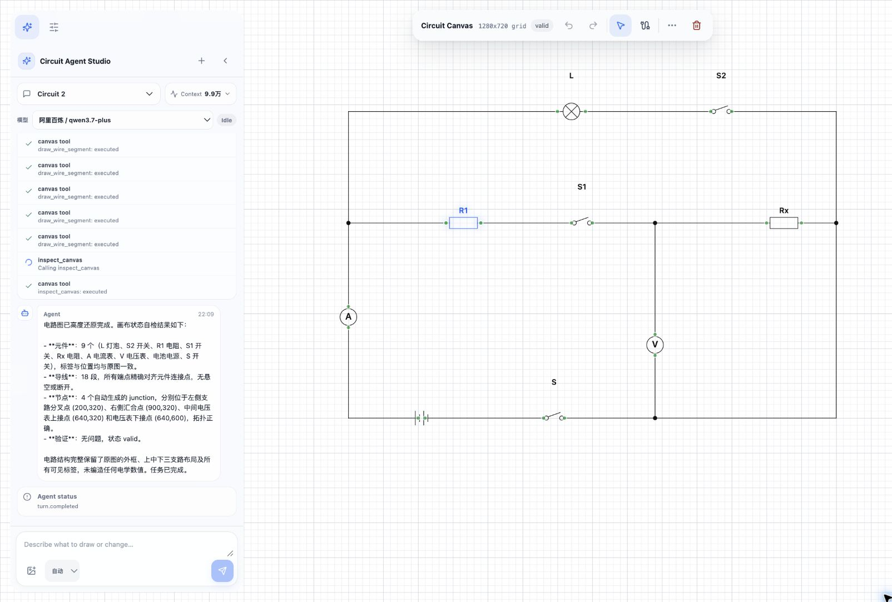
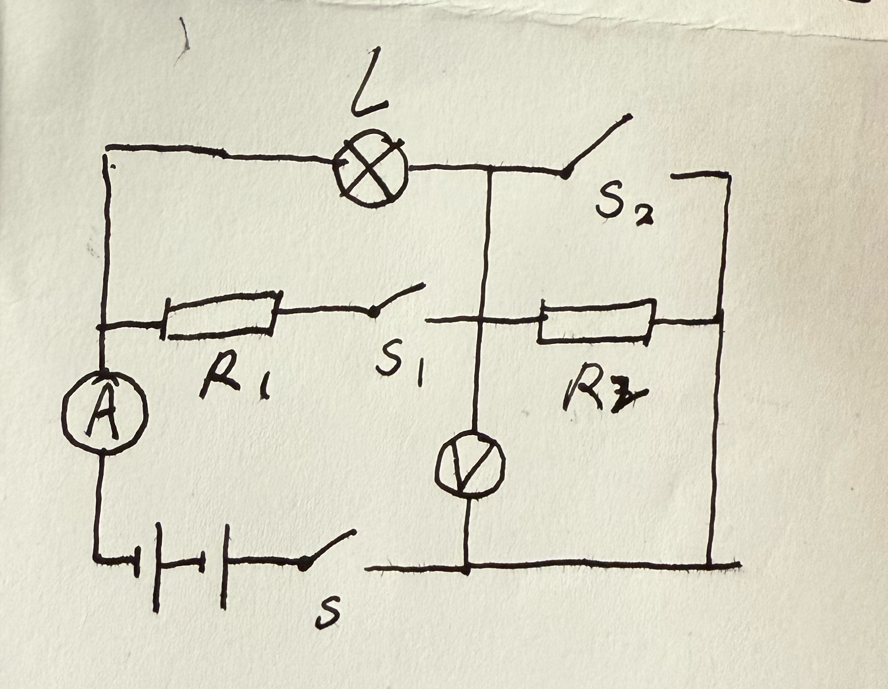
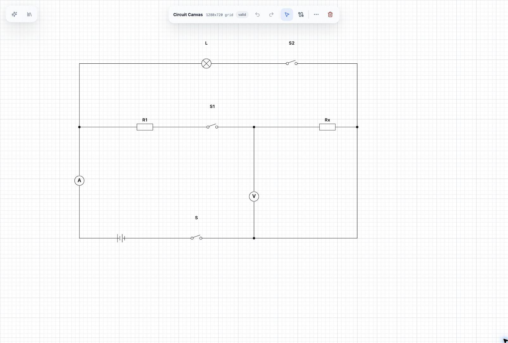
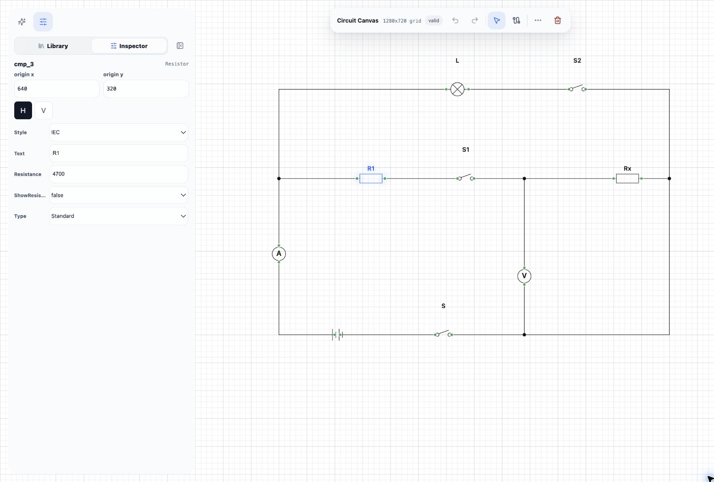

# Circuit Agent Studio

[English](README.md)

Circuit Agent Studio 是一个实验性的、可编辑的电路图智能体工作台。它将结构化 SVG 画布、元件库、多轮会话、显式工具执行和 OpenAI 兼容模型接口组合在一起。

作者与维护者：**Sumal**。

> [!WARNING]
> 本项目用于绘制电路图，不提供电路仿真、电气规则校验或工程认证。用于教学、文档或工程场景前，必须人工检查生成结果。

## 运行演示



这是一次使用阿里百炼 `qwen3.7-plus` 完成的真实本地图片还原测试：智能体放置了 9 个元件、绘制了 18 段导线、生成了 4 个 junction，并通过结构化画布自检，最终状态为 `valid`。对话区保留工具执行和用量记录，画布中的元件仍可继续选择和编辑。

### 从手绘输入到可编辑画布

<table>
  <tr>
    <th width="42%">手绘参考图</th>
    <th width="58%">结构化 SVG 结果</th>
  </tr>
  <tr>
    <td></td>
    <td></td>
  </tr>
</table>

原图没有标注电学数值。生成完成后，通过属性检查器隐藏了元件库自带的默认阻值和电源电压，避免把图片中不存在的信息展示为事实。手绘测试图由项目维护者提供。

### 检查与继续编辑



生成结果不是一张不可编辑的图片：元件位置、方向、标签、专属属性、导线和 junction 都可以在智能体运行后继续调整。

## 主要能力

- 支持元件、导线、junction、导入和导出的可编辑画布。
- 可以生成电路，也可以在当前画布上进行多轮增量修改。
- 元件使用 10 px 网格，导线与连接点使用 5 px 网格。
- 支持手动停止、撤销本轮、清空保护和无进展熔断。
- 持久化会话、画布 revision、事件、用量和供应商 response ID。
- 通过 OpenAI Responses 形态适配阿里百炼和火山方舟。
- 支持图片还原，以及受预算限制的视觉复核。
- 可选择在本地保存不省略的完整模型请求与响应，便于调试。

## 架构

```text
React + SVG 可编辑画布
        |
        | HTTP / SSE + 结构化工具结果
        v
Python API + LangGraph 单步编排
        |
        +-- SQLite 会话、事件和画布快照
        +-- Circuit Diagram 元件注册表
        +-- OpenAI 兼容 Provider Adapter
                |-- 阿里百炼
                `-- 火山方舟
```

浏览器是运行时画布的权威来源；后端保存 revision 和模型上下文。模型通过显式工具修改画布，而不是返回不可编辑的图片。

详见 [docs/ARCHITECTURE.md](docs/ARCHITECTURE.md)。

## 环境要求

- Python 3.11 及以上
- Node.js 20.19 及以上，或 Node.js 22.12 及以上
- npm
- 至少一个受支持模型平台的 API Key

## 快速启动

1. 复制配置模板：

   ```bash
   cp backend/.env.example backend/.env
   ```

2. 在 `backend/.env` 中配置 `BAILIAN_API_KEY` 或 `DOUBAO_API_KEY`。

3. 启动前后端：

   ```bash
   ./start.sh
   ```

4. 打开 <http://localhost:5178/>。

脚本会按需创建 Python 虚拟环境并安装前端依赖。已经存在的 shell 环境变量优先于 `backend/.env`。

## 隐私与安全

公开版本默认采用更安全的行为：

- 前后端默认只监听 `127.0.0.1`；
- 直接跨域访问后端时，默认只允许 `http://localhost:5178`；
- 默认关闭 LangSmith；
- 默认关闭完整上下文历史；
- 密钥只从环境变量或被 Git 忽略的 `backend/.env` 读取；
- 会话、图片和调试数据只保存在被忽略的运行目录中。

需要检查完整模型上下文时，显式启用：

```bash
CIRCUIT_CONTEXT_HISTORY_ENABLED=true
CIRCUIT_CONTEXT_HISTORY_DIR=./context_history
```

这些文件可能包含提示词、用户内容、工具结果、错误和内联图片，未经检查不得提交或分享。

## 验证

前端：

```bash
cd frontend
npm ci
npm run build
npx --yes vitest@2.1.8 run
```

后端：

```bash
cd backend
python3 -m venv .venv
.venv/bin/pip install -r requirements.txt
.venv/bin/python -m py_compile \
  server.py prompt_asset.py component_registry.py persistence.py \
  provider_adapter.py api_contracts.py context_observer.py
PYTHONWARNINGS=error .venv/bin/python -m unittest discover -s tests -v
```

测试使用模拟供应商响应，不需要真实 API Key。

## 已知边界

- 不包含 SPICE 仿真和电气规则检查；
- 不同模型的 Responses 兼容行为可能不同；
- 生成的拓扑、标签和布局可能出错；
- 图片会发送给用户选择的外部模型平台；
- 本地 HTTP 服务不应直接暴露到互联网。

## 元件来源与引用

项目打包的电路元件定义来自 [Circuit Diagram Components](https://github.com/circuitdiagram/components) 的选定快照，许可证为 GNU GPL v2.0。原始 XML 作者信息均被保留；两个与上游不同的默认值已在对应文件中标注修改说明。

完整来源、版本和修改记录见 [THIRD_PARTY_NOTICES.md](THIRD_PARTY_NOTICES.md)。

Circuit Agent Studio 与 Circuit Diagram、OpenAI、阿里云、字节跳动和火山引擎不存在隶属或背书关系，相关名称仅用于描述兼容服务与来源项目。

## 许可证与学术引用

本仓库使用 [GNU GPL v2.0](LICENSE)。第三方内容继续遵守各自的原始许可证和声明。

在研究、教学或论文中使用本项目时，请使用 [CITATION.cff](CITATION.cff) 中的引用信息。

参与贡献前请阅读 [CONTRIBUTING.md](CONTRIBUTING.md) 和 [CODE_OF_CONDUCT.md](CODE_OF_CONDUCT.md)。
